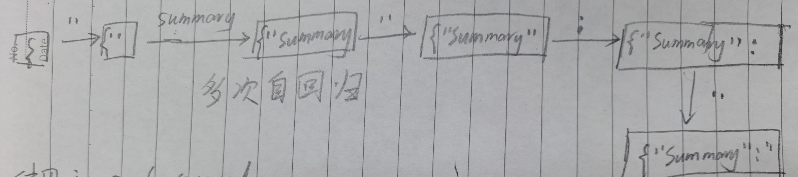
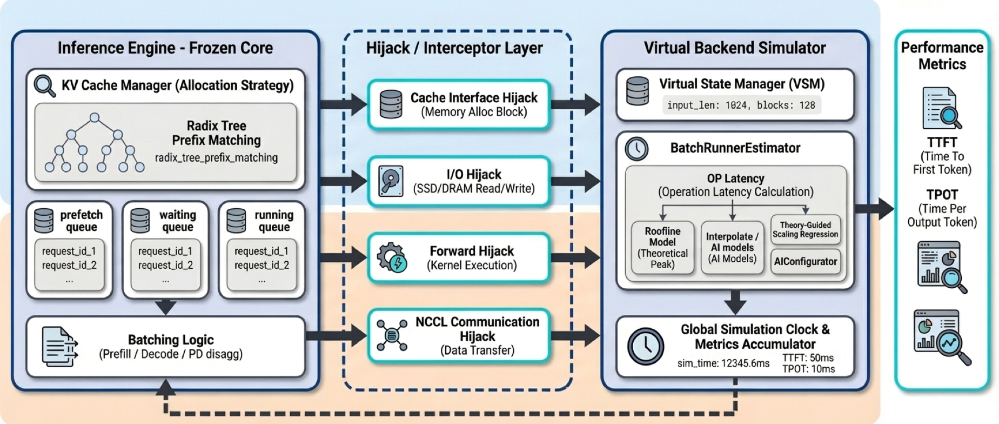

# SGLANG

sglang=structured generation language

LM program指的是在程序调度和控制LLM的生成。（各种agent）

LM program有两个特点：1\. 通常在控制流中需要多次调用LLM 2\. 输入和输出一般是结构化的。

LM program面临两个困难：1\. LLM模型的不确定性，不确定性导致需要做很多额外的工作，如： 2\. 重复计算和存储占用。

SGLang就主要围绕这两个困难展开。

编译结果为SGLang IR（计算图的形式，走Graph Executor来执行），


## 前端

### SGLang原语


红色的都是sglang的原语


前端对应的是LMQL/DSPy

（目前前端已被官方标记为deprecated，不再演进，未来的演进方向是和vllm一致的HTTP API方式）

当前的使用方式：

```Python
from sglang.test.doc_patch import launch_server_cmd
from sglang.utils import wait_for_server, print_highlight, terminate_process

server_process, port = launch_server_cmd(
    "python3 -m sglang.launch_server --model-path qwen/qwen2.5-0.5b-instruct --host 0.0.0.0 --log-level warning"
)

wait_for_server(f"http://localhost:{port}")
print(f"Server started on http://localhost:{port}")
```

## 后端

### KV复用

#### Radix tree

Radix tree是压缩前缀树，和prefix tree\(前缀树，又称字典树\)的主要区别就在于radix tree的一个节点不止可以存储单个点，还可以存储一段连续的序列。


> 树节点可以是单token粒度（page\_size=1）也可以配置page\_size（为了提升flashAttn速度）
> 
> 

> fork原语的特殊优化：先发送prefix，确保KV插树，再发送剩余prompt。
> 
> 

同样可以将用户的cache\_salt作为不同用户之间的请求隔离，在树的根节点分叉出不同的分支。

#### Cache\-aware scheduling

为了避免不相关对话交替调度导致prefix命中率下降，编排batch时会根据prefix命中长度来给请求排序（longest\-prefix\-match），优先处理长度长的请求\-\>对应dfs算法。

缺点：会导致一些请求饿死

改进方法：

1. 老化：给请求记录超时时间，超时执行。

2. dfs\-weight算法：不只看前缀匹配长度，还会看前缀子树下积压的请求数和等待时间。如果冷门子树下积压的请求数多、等待时间长，就会执行。

3. windowed\-LPM：只对固定窗口下的请求做LPM排序，不会让请求不限制的塞入队列头。

4. chunked\-prefill：引入chunked\_prefill\_size，命中长度低的请求的prefill阶段计算多，限制一个冷门长请求计算显存不足or占据GPU时间过长。

#### KV语义匹配

1. Position\-Independent Caching/CacheBlend机制

    非前缀kv复用

    1. 计算特征/语义相似度\-\>prefix可以非连续

    sglang使用CacheBlend，会直接把kv管理的后端替换为LMCache，后端的kvcache组织方式不再是radix tree，而是chunk hash的方式。而vllm使用，则会将kv管理分为两步，请求先使用vllm自己PagedAttention Block Hash（L1）来查找前缀命中，当前缀出现截断了，把后续未命中序列分块之后交由LMCacheConnectorV1（L2）。

    1. 采用特殊分隔符进行切分\-\>不同的文本块（段落/文档）

    2. 重置哈希起点。

    3. 块内token需要严格保持一致。

    2. 位置编码修正与局部重算\-\>复用KV，修正Key的RoPE进行修正。

    3. 复用块之间的token局部重算，极少数受影响最大（只跑第一层，获取第一层KV，对比KV的向量偏移，排序）进行token重算\(10%\-15%\)

2. SemBlend：

    真正的语义匹配


    核心donor search：

    1. Chunk fast path（chunk粒度）

    将请求切分为chunk，按照chunk和当前保存的倒排donor\(chunk为key， donor为value）做精确hash对比。

    2. embedding search（request粒度）

        1. 对整个请求的embedding做余弦值对比，相似度最高的topk，相似度最低是0\.6

        2. 如果topk不足5个时，按照chunk粒度找到chunk匹配最多的donor来补充到topk

        3. 之后将topk donor和请求计算Jaccard，过滤低于0\.5的donor。


        4. 对过滤后的donor计算reuse ratio。这个方法为滑窗计算hash（默认16），根据hash判读当前请求的token窗口是否在donor中有命中。最后根据cosine x reuse ratio来排序，对排名最高的三个donor进行边界对齐。

        5. 边界对齐方法：

            1. 滑窗计算hash（默认64），根据hash精确匹配, 最多选择8个segment。超过50%即按照当前方法作为最终结论否则继续执行。

            2. 对chunk（默认256）进行模糊匹配，根据两个chunk之间的token重叠率筛选，筛选之后计算置信度，置信度满足0\.95保存。

            3. 计算chunk hash（256）的精确匹配，过滤孤立chunk。

3. 网关层语义缓存（Semantic Cache）\+Sglang路由。（架构上从网关层做语义匹配，模型层只做精确生成）

路由层根据语义进行路由，满足阈值可以直接返回缓存结果。

#### 线性注意力KV

缓存处理完的一段prefix后的state\(state checkpoint\)。 当发生cache miss，从最近可用state重新计算。

SGLang在处理线性注意力时，有两个行为level。

1. level2:在请求结束和prefix分叉的位置保存checkpoint

2. level3:在level2的基础上增加在prefill chunk和decode固定间隔创建checkpoint。

混合注意力会导致不同层cache的命中率不一致，选择full和线性命中最小的cache长度开始重新计算。

vllm：默认level3行为，可以通过设置Mamba Block Size来控制checkpoint 间隔。请求结束也会保存，prefix分叉位置目前作为可选功能，非默认。

#### Radix KV分布式部署

1. TP

维护一棵全局共享的radix tree\(主进程\) // 和vllm中的allocator作用一致。

不同的GPU存不同注意力头，因此所有GPU只需要存自己注意力头的KV，索引ID可以保持一致。主进程可以一次批量调度所有GPU，不需要分开处理。

2. DP

    1. 各自独立维护 /不共享

    2. 通过SGLang Router来避免cache存在A，但是request却发给了B

    SGLangRouter\-\>Cache\-AwareRouter/Prefix\-Aware Load Balancer

    1\)\. Router维护全局前缀树，value不存储KV地址，改为workerID。全局前缀树是近似GPU的radix tree，因为他默认只依赖输入prompt，不会去根据生成的token来更新树（这部分特性是可选的，后续也实现的有会根据GPU生成token来进行同步的，但是会引入同步消耗，适合多轮增量交互的场景，如agent\)

    2\)\. 根据全局前缀树，选择前缀缓存最长的worker来路由（长前缀优先匹配）。如果该GPU排队过长，会选择空闲的GPU进行重建（负载感知）。

3. DP Attn for MLA

    MLA保存的kv和head无关，只有一份。按照TP切分，需要把kvcache在不同的rank中都保存一份，严重浪费显存。


### Jump\-Forward

#### Compressed FSM

对于JSON这种结构化的输出，原始的decoding效率差。因为从语法规则上来说，有一些是确定性的输出，但是也需要一次完整的自回归，资源浪费。

举例：

对于输出\{"summary":"，总共五个字符。需要经过



使用Compressed FSM来加快decoding过程，上述的FSM多条边都只有一个分支，因此我们通过文法分析器CFSM来压缩多条边为一条边。


压缩的含义\-\>多个token直接发给LLM\(对这多个token做prefill\)

应用场景：

1. 规范格式/跳过废话（我将用最直白，最不绕弯子\.\.\.）

2. DSL零语法错误生成（JSON等语言）

3. 强制拒答。（检测违规匹配，直接替换为固定拒答模板发给LLM）

4. 在中转站让DeepSeek伪装Claude\.  :\-\)

5. select原语（将选项拼到prompt后面，计算不同prefill的token的条件对数概率）。

#### XGrammar

> 正则文法是上下文无关文法的一个子集。两者的区别在于能否允许出现嵌套。JSON其实是上下文无关文法\{\}。
> 
> 
> 
> 

上述的CFSM只能做正则语法的分析，对于上下文无关文法无能为力。

XGrammar使用PDA\(PushDown Automaton,下推自动机\)来替换默认的FSM，并且使用c\+\+开发，效率极高。

PDA相比FSM主要多了一个栈，对应的状态转移也多了入栈、出栈操作，对应json中就是**\{"** 入栈和**\}"** 出栈。

#### Jump\-Forward vs MTP

在当前实际的SGLang使用中，一般不会使用上面介绍的jump\-forward技术。

主要原因为：

1. 和投机推理冲突。

    1. 投机推理状态机和CFSM状态机冲突

    2. 重新分词导到草稿模型的采样和目标模型位置对不上，影响了投机推理的无损特点。

2. 影响Cot，当前的大模型的输出会经过大量的Cot之后再输出，替换模型输出会导致影响Cot的效果，甚至出现乱码

Jump\-Forward和投机推理的理念也是处在一个生态位，因此当前基本上被投机推理替代了。

#### SGLang\+XGrammar\+MTP协同优化

问题：MTP出现的token不符合JSON语法，浪费算力。

解决：

Drafting阶段（带约束的草稿）：

1. 逐层掩码剪枝。具体做法是，根据草稿树，生成合法token位掩码（存在多选择）

2. 在投机采样topk之前，强行将非Mask的token概率改为0\.

验证阶段（带约束的验证）：

验证阶段需要保证目标模型的采样概率和draft模型的采样概率一致。因此需要把同样的mask发给目标模型，让目标模型也做非Mask的token概率修改。（如果bitmask在drafting阶段计算过，可以直接复用）

1. 将草稿树序列化为\(draft\_tokens, retrieve\_next\_token, retrieve\_next\_sibling\)

```Python
xgr.GrammarMatcher.traverse_draft_tree(
    retrieve_next_token,    # int64 一维数组：指向当前节点的“第一个子节点”下标（-1 表示无子节点）
    retrieve_next_sibling,  # int64 一维数组：指向当前节点的“下一个兄弟节点”下标（-1 表示无兄弟）
    draft_tokens,           # int64 一维数组：每个节点预测出的 Token ID
    bitmask,                # int32 二维张量 [num_nodes, bitmask_size]：输出缓冲区
    batch_index=0,          # 当前请求在 bitmask 缓冲区中的起始行偏移
    time_threshold=-1.0     # 超时熔断阈值（防止极端大树拖慢主线程）
)
```

2. DFS生成整棵树的Bitmask统一发给GPU


### API Speculation

api投机指的是sglang后端接入的是Open API接口的闭源模型，我们只能通过接口来交互，不能直接去调度模型，通过一些工程上的技巧来节省token，减小请求延迟。

```Python
S+=context+"name:"+gen("name",stop="\n")+"job:"+gen("job",stop="\n")
```

如上面的代码，我们希望模型生成两部分的内容，分别是name:\[name\]，和job:\[job\]。正常情况下会分为两次Open APi交互。

SGLang可以选择将中间的stop="\\n"去掉，故意让模型多输出一部分，将多输出的部分缓存下来。和后续的"job:"进行字符串匹配，如果匹配，就直接将缓存作为第二次的输出。不匹配，再重新调用Open API交互。

hit\-\> one longer gen

miss\-\>two gen


### HiCache

核心概念：

L1:GPU memory

L2:host memory

L3:distributed storage\(mooncake/3FS/NIXL/AIBrip\)


其中L1\\L2在不同的instance间彼此隔离。L3在所有instances间共享。


#### Local match\(L1\\L2\)

Local match:请求从radixtree根节点开始匹配。


Load\_back策略（启发式）：在L2命中的kv cache会通过逐层掩盖的方式后续加载到L1再使用。

- 待加载的 KV Token 数量是否低于 `load_back_threshold`（传统实现中为 10 Token）。

- 当前load\_back策略的内存配额是否耗尽。

- GPU KV Cache Pool 是否能够分配足够空间。

#### Prefetch\(L3\-\>L2\)

匹配长度超阈值\(default:256）才会进行prefetch

**策略** \(GPU准备好进行prefill时，是否要等待prefetch操作）：

Best effort：GPU准备好就立即执行prefill\(prefetch可能只完成部分）

wait\_complete:等待所有的prefetch操作完成再执行prefill

time\_out:等地啊prefetch完成或者超时后，执行prefill

因此从L3到L2的加载时间主要和请求在进入prefill batch前的排队时间。


#### write\_back\(L1\-\>L2\-L3\)

**策略** ：

write\_through:立即写入下一层级\(L1\-\>L2\-\>L3\)
write\_through\_selective:只写入高频数据\(访问次数到达阈值再写入下一层级）

write\_back：上一层级发生evicited时再写入下一层级。

#### Multi\-Rank Synchronization

对于TP并行，需要确保所有rank命中的长度保持一致\(理论上应该是自然保持一致，但实际上可能会因为程序执行\\通信速度差异导致在GPU准备好计算时，不同rank上的kv cache长度不一致。需要做一次all\_reduce, 同步所有rank的命中长度（按最小长度）

#### Data Transfer Optimization

1. Zero\-Copy Data Transfer:

    L2\-\>L3传输时消除缓冲区的copy。

    从$CPU\xrightarrow{memcpy}缓冲区\xrightarrow{RDMA}L3
$

    变为 

    $CPU\xrightarrow{RDMA}L3$

2. Batch\-Oriented Data Organization

    KV在L2\-\>L3传输时会按照page存放，减少IO次数

3. CPU\-to\-GPU transfer optimization

    1. 计算掩盖（层间掩盖）

    2. GPU\-assisted I/O kernels: 专门的GPU kernels优化速度

4. PD分离优化

    P和D共用L3层级\-\>Decode的结果可以提高Prefill阶段的命中率

### HiSparse

（for DSA, only PD disaggregation mode and decode instance\)

#### 工作流：

1. Forward decode\-\>生成下一个token

2. Top\-k selection

3. Swap\-in:CUDA kernel从host加载top\-k KV到device

    短序列：全存在GPU

    长序列：命中检测\-\>LRU\-\>\(host\-\>device copy\)

4. Decode attention\-\> 使用Top\-k计算Attn

5. Eager backup\-\>异步复制新的KV到host

#### PD Disaggregation Integration\(Dirct  to host\)

$Prefill\ GPU\xrightarrow{RDMA}Decode\ Host\ Pool(pinned\ CPU\ mem)\xrightarrow{根据Top-kswap-in}Decode\ GPU\ KV\ Buffer$

Shared\-Index prefetch:Dsv4\.1 Flash等

1. shared\-Index：多个layer共用Top\-k Token索引

2. Prefetch：根据索引提前prefetch后续层的kv。（不需要重新计算命中和LRU算法，可以直接进入\(host\-device\)阶段）

### PD分离

sglang中的pd分离架构为将两个server变成动态链接的方式，在新请求到达的时候，选择最低负载的prefill和decode来进行动态链接。这样有个好处就是方便集群动态扩容。sglang甚至实现了prefill和decode实例之间的动态切换。


### SGLang Simulator



核心思想：保持原生的sglang代码不做修改，确保调度执行逻辑和仿真调度一致。

SGLang Simulator intercepts SGLang through a **two\-level hook system** \(`builtins.build_class` \+ `sys.meta_path`\) without any source modification。


#### 劫持

劫持主要有两种实现方式：

**Class Hook：**`builtins.build_class`

拦截 Python 类的构造过程，在类定义完成时修改方法。

```Python
original_build_class = builtins.__build_class__

def hooked_build_class(func, name, *args, **kwargs):
    cls = original_build_class(func, name, *args, **kwargs)

    if name == "ModelRunner":
        cls.forward = fake_forward
        cls.sample = fake_sample

    return cls
```

当前通过class hook主要mock的几个类。


Class hook mock函数也尽量保证原始函数的执行，尽量使用wrap的方式来mock。

比如Scheduler的`get_new_batch_prefill`。

```Python
def wrapped_get_new_batch_prefill(self, *args, **kwargs):
    start = time.perf_counter()
    result = original_get_new_batch_prefill(self, *args, **kwargs) # 原函数
    C_SchedulerHook.GET_NEW_BATCH_PREFILL_TIME_COST = (
        time.perf_counter() - start
    )
    # 插入计时、统计、逻辑时间控制。省略
    return result
```

**Module Hook：**`sys.meta_path`

在 Python 模块导入过程中介入，处理需要替换的模块或 GPU Kernel 加载逻辑。

用None替换了对CUDA的加载，解除了对GPU对依赖。

```C++
def install_load_utils_stub() -> None:
    module_name = "sgl_kernel.load_utils"

    module = sys.modules.get(module_name)

    if module is None:
        module = types.ModuleType(module_name)
        module.__package__ = "sgl_kernel"
        sys.modules[module_name] = module

    module._load_architecture_specific_ops = (
        lambda *args, **kwargs: None
    )
    module._preload_cuda_library = (
        lambda *args, **kwargs: None
    )
```

#### 输入格式

支持三种输入方式：

1. **Synthetic Workload**

```SQL
python3 benchmark/simulator/bench_serving.py \
  --simulator-mode offline \
  --backend sglang \
  --base-url http://127.0.0.1:30000 \
  --model /path/to/model \
  --dataset-name random \
  --random-input-len 2048 \
  --random-output-len 256 \
  --num-prompts 1000 \
  --request-rate 20
```

采用柏松过程模拟时间，token id随机生成。

2. **ShareGPT Workload**

```JSON
[
  {
    "conversations": [
      {
        "from": "human",
        "value": "Explain continuous batching"
      },
      {
        "from": "gpt",
        "value": "Continuous batching is..."
      }
    ]
  }
]
```

请求到达时间依然采用柏松过程模拟，但是tokenid从dataset中采样，格式如上。

3. Autobench Trace

```Python
{"arrival_time": 0.0, "input_length": 1024, "output_length": 128}
{"arrival_time": 0.015, "input_length": 4096, "output_length": 256}
{"arrival_time": 0.020, "input_length": 2048, "output_length": 64}
```

请求到达时间使用真实的时间戳。

#### KV cache管理

仿真和真实执行的一个关键差异：

llm模型output的结果产生的kv cache也会影响缓存命中，仿真没有执行真正的forward，无法得到真实的output值。

|对比维度|真实 SGLang|SGLang Simulator|仿真误差|
|---|---|---|---|
|**Output Length**|模型动态生成，由 EOS、Stop 条件或最大长度决定|Workload 预设输出长度|影响 Decode 轮数、KV Cache 占用和调度|
|**Output Token 内容**|模型根据 Logits 采样得到真实 Token ID|使用固定 Token ID `1` 占位|影响生成历史相关的 Prefix Cache 命中准确性|

#### BLOCKING和OFFLINE模式。

- OFFLINE：使用逻辑时间（Logical Time）模拟 GPU 执行，不需要真的等待。

- BLOCKING：使用真实墙钟时间（Wall\-clock Time）推进执行，通过 `sleep` 模拟 GPU 计算耗时。

#### Predictor

1. AISimulate

输入模型、硬件、Batch 信息，根据算子性能数据库，通过性能模型估算。

2. ML

使用机器学习对真实执行数据进行拟合。

3. Replay

查表。未记录的batch采用最近邻匹配。

三个predictor最终都是获得一个forward的执行时间，用于scheduler的时间记录。

#### 并行仿真

当前SGLang Simulator只会起一个worker。但是实际的TP并行，会给每个rank起一个worker。

当前多TP的仿真时间只会针对一个worker进行模拟，具体TP带来的影响交给了predictor来模拟一次前向的处理时间。

当前仿真不包含多DP仿真，不包含sgl\-router的行为（已进入官方的Roadmap）。


QA：vllm和sglang的区别在哪里？

最初的sglang的核心思想是前端DSL和后端SRT协同优化，但是经过几年的演进，目前sglang的工作中心主要转向了后端SRT的优化。在前端调用上已经和vllm趋同，都使用异步API server的方式。

sglang另一个核心思想是JF，当前也已被投机推理给替代。

最后在kv的管理上，是sglang依然保留的和vllm的主要区别。

vllm和sglang经过多年思想碰撞，趋同演进，已经非常趋同了。如sglang借鉴vllm的chunked prefill概念、借鉴vllm的异步api server，vllm借鉴sglang的radix tree思想，修改入队方式为反向入队，抛弃了v0的时间戳概念，evicted策略也变为了LRU。


前面的区域，以后再来探索吧。


