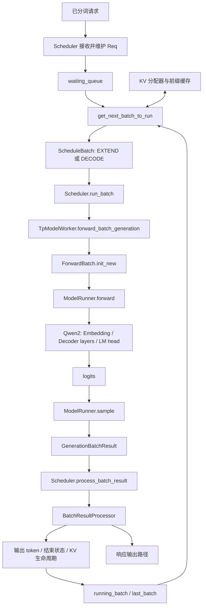

# 调度循环与模型执行

状态：学习中，覆盖普通非 overlap 文本生成主路径。
源码基线：`0957288be0818686034f33a3a7441434e4f5ba33`，核对日期：2026-10-19。
证据：源码核对，未运行模型。具体配置、推演和边界见 [请求与调度功能文档](../features/01-requests-and-scheduling.md)。

## 1. 模块关系

下图是普通路径的模块与数据流图；分词和响应部分仅表示概念上的服务边界，尚未展开 IPC 和完整进程拓扑。



图中的 ModelRunner 到模型是展开后的概念执行关系；具体 `_forward_raw()` 分支和 eager/graph 后端在后续阶段核对。计算 attention 时也会通过执行侧 KV 元数据读写缓存，图中没有画出所有缓存边。

## 2. 主循环及跨轮关系

`event_loop_normal()` 的语义摘录如下，省略暂停、统计和自检分支，不作为可直接运行的替代实现：

```python
ingest_requests()
plan = get_next_batch_to_run(running_batch, last_batch)
running_batch = plan.running_batch
batch = plan.batch_to_run
if batch:
    result = run_batch(batch)
    process_batch_result(batch, result)
last_batch = batch
```

`get_next_batch_to_run()` 不只是“从队列取一个元素”：它处理跨轮 batch 的过滤/合并，尝试构造 prefill，再决定是否推进 decode。在本讲无额外策略的配置下，有可运行 prefill 时优先执行 prefill；否则执行非空 running batch 的 decode。

prefill 的输出 token 被提交后，请求仍可处于生成状态。下一轮将可继续的 prefill 请求合并进 running batch。decode 前 `update_running_batch()` 过滤不再需要运行的请求、检查资源，再准备输入；其回退细节尚未展开。

## 3. 数据与状态的所有权

| 信息 | 主要维护位置 | 对执行/仿真的含义 |
| --- | --- | --- |
| 请求 prompt、输出和结束状态 | `Req` 与真实结果处理逻辑 | 不由耗时表修改 |
| 谁进入本轮、执行模式、token 预算 | Scheduler、SchedulePolicy、ScheduleBatch | 必须来自真实调度选择 |
| 本轮模型输入与执行元数据 | ScheduleBatch → ForwardBatch | 是算子描述和代价查询的来源之一 |
| KV 容量、索引与缓存状态 | 内存配置器、分配器和所选缓存实现 | 逻辑约束真实保留，设备存储适配另行设计 |
| next-token logits 与采样结果 | 模型执行和采样路径 | 替代执行需提供真实上层所需的结果契约 |
| 时间与操作完成 | 当前生产设备/主机机制；仿真方案待接入 | 打桩代价必须转换为适当的完成事件 |

## 4. 模型时间步与调度轮次

一次调度轮次可以只执行新请求的 prefill，也可以推进多个请求的 decode。某个请求不保证每个调度轮次都执行。

普通无前缀命中的完整 prefill 读取全部 prompt 并产生第一个生成 token；一次普通 decode 消费上一输出 token 并产生下一个。因此调度中的“一次执行”对应模型的一次 forward，而不是一个请求完整生成全部输出。

多个请求在同一 decode batch 中共享模型权重，各自保持独立上下文。每层 KV 存储覆盖已经作为模型输入计算过的位置，刚采样出的 token 通常要到下一次 forward 才拥有对应 KV。

## 5. 当前配置边界

- 普通生成、单 rank、非 overlap、无投机解码，不代表目标 NPU 最终部署配置。
- 混合 prefill/decode 在 `_get_new_batch_prefill_raw()` 的条件分支中处理，本讲推演明确关闭。
- chunked prefill 的中间块不等同于一次完成 prompt 并提交生成 token 的 prefill。
- overlap 中提交、完成和处理结果可以跨轮交错，不能照搬本讲串行时序；阶段 5 专门展开。
- 尚未核对具体设备 stream/event、完整请求传输链路与计时边界。

## 6. 性能仿真的候选接入边界

已确认必须保留：主调度循环及目标配置路径、batch 决策、请求状态转换、KV 管理逻辑。

拟议适配：设备计算与通信代价、设备存储、必要的执行结果以及完成事件。它们的准确接入位置需要阶段 2、3、5 进一步确定，本讲调用图不等于完成了接口设计。

用例：A 执行期间 B 到达。如果改变 A 的打桩耗时，B 是否能在下一次真实接收时点被看见可能改变，后续 batch 也可能改变。因此执行时间必须进入调度反馈，不能先固定批次序列再只统计总时长。

批内长度差异也应沿真实 batch 传入执行代价模型：算子调用接收逐请求 query/KV 长度并返回整个调用的耗时，而非给每个请求分配独立、互不争用的设备。真实 Scheduler 负责组 batch，kernel 负责设备任务分配，性能模型描述其代价；这三者不可混为一个仿真调度器。具体讨论见 [功能文档第 8 节](../features/01-requests-and-scheduling.md)。
