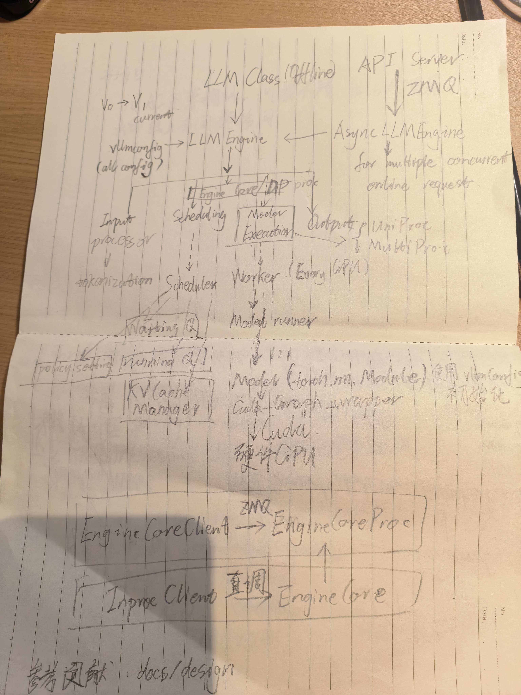
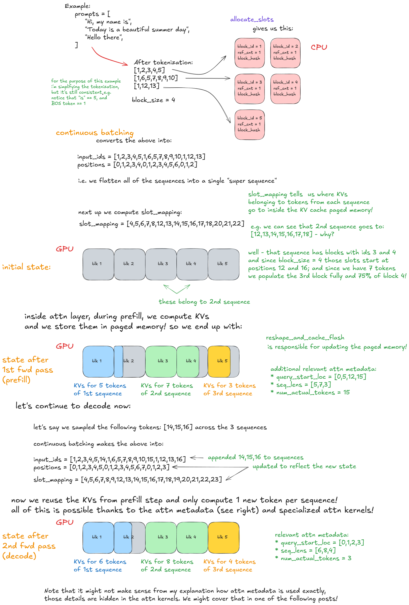
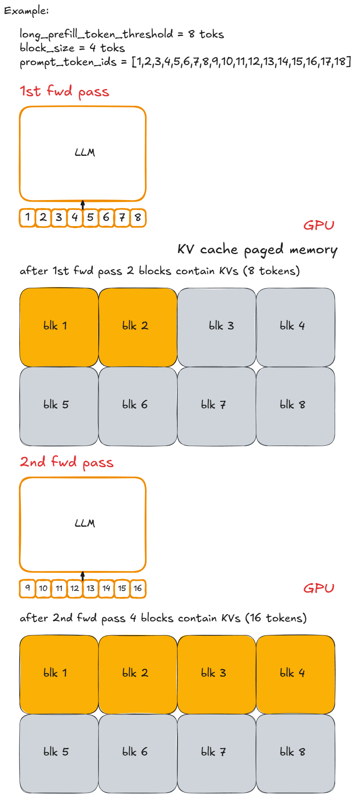
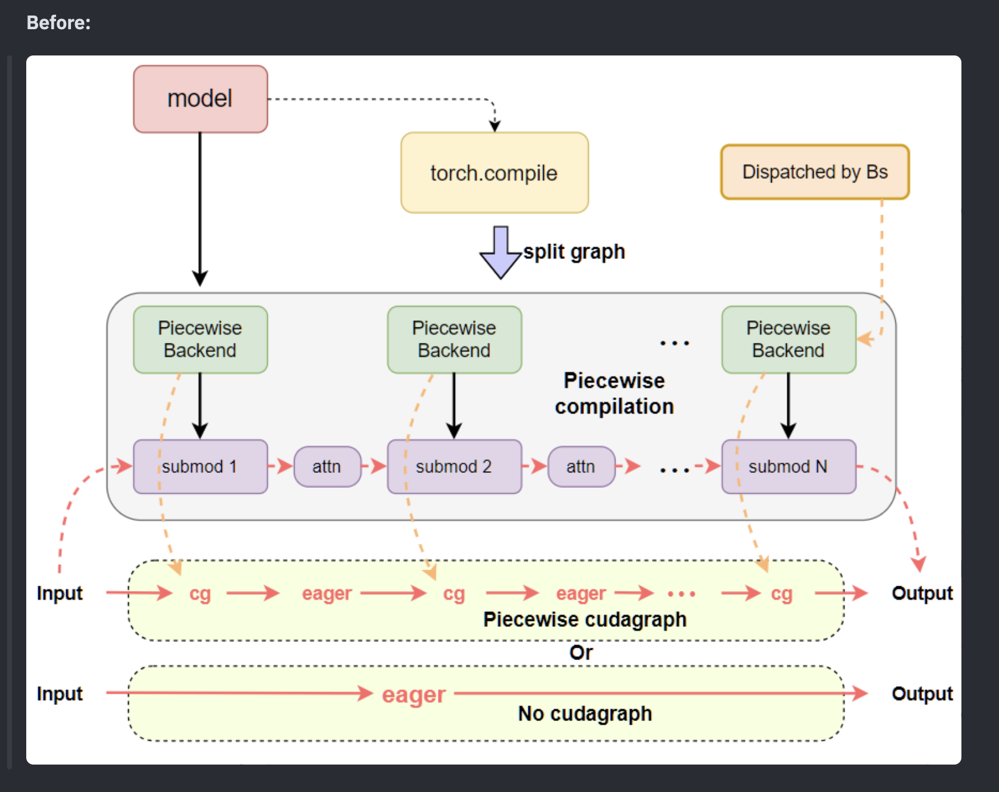

# VLLM

## Introduce

Q：推理框架是什么？

换个问法，推理框架解决了什么问题？\-\> 部署一个LLM模型用来推理！

> 把大象放进冰箱里
> 
> 

部署一个大型LLM模型来提供推理服务会遇到什么问题？

1. Load\_Model

    1. Sharding Model

    2. Quantization

2. Get\_Prompt

    1. API\_Server

    2. Schedule

    3. Continuous batching

3. Forward

    1. KV cache

    2. Paralle 

    3. Specdec

    4. Scale up

    5. Kernel compile

> 山僧不识英雄汉，只恁晓晓问姓名
> 
> 

## Architecture

> 暂定
> 
> 



## KV Cache Manager

存储依靠三元组BlockHash\{parent hash value, block tokens, extra hashes\}

Parent hash value: 上一个chunk的BlockHash三元组的hash

Extra hashes

1. Lora ID/多模态\-\> token一致但是对应的kv值不一致

2. Cache salt\-\>kv值一致，但是希望kv不共享\-\>不同用户/组织\-\>保护隐私\-\>避免从TTFT推测是否被问过这个问题\-\>研究进度/股票\(只放在第一个chunk上\)

```Python
class KVCacheBlock:
    # The block ID (immutable)
    block_id: int
    # The block hash (will be assigned when the block is full,
    # and will be reset when the block is evicted).
    block_hash: BlockHash
    # The number of requests using this block now.
    ref_cnt: int

    # The pointers to form a doubly linked list for the free queue.
    prev_free_block: "KVCacheBlock | None" = None
    next_free_block: "KVCacheBlock | None" = None
```


请求出现duplicated block：

```text
已有缓存
Block Table: [0 (ABCD), 1 (EFGH)]
Cache Blocks: 0, 1
新来请求：
Prompt: [A, B, C, D, E, F]
Output: [G, H, I]

Time 0:
  Tokens: [A, B, C, D, E, F, G]
  Block Table: [0 (ABCD), 3 (EFG)]
  Cache Blocks: 0, 1
Time 1:
  Tokens: [A, B, C, D, E, F, G, H]
  Block Table: [0 (ABCD), 3 (EFGH)]
  Cache Blocks: 0, 1, 3
```

v1实现：延迟到请求结束（ref=0）释放

v0实现：监测到重复立即释放

free（ref==0）：反方向的将KVCacheBlock添加到free queue中，因为parent先释放，后续的都不能用。释放是先释放队列前边的。

eviction：从free queu队头弹出（LRU）

#### Hybird kv cache

Allocator代表管理kv cache的额外成本，hybird kv cache会需要多个allocator。因为Attn不同对应的kv page size不同（full vs swa）


几种场景：

1. 每层对应一个block\_size\-\> allocator调用多次（layers数量个allocator\-\>block ID不共用\-\>一个ID只对应一层

2. 假如full vs swa配比如\(10 : 20\) 1:2\-\> 使用10层（最大公约数）作为一个group，分为三个group，分别是\(group0:full0\-9, group1:swa 0\-9, group2:swa 10\-19\) 

3. 假如配比是（52:10），最大公约数为2，则group需要36个，代价和逐层一个allocator一样。解决方案为padding

改为60:10，最大公约数为10\. group变为7\.

4. kv\_hidden\_size不同。？？？

5. Kv sharing。 共享的层不需要allocator。dsa4\.1

Prefix Cache

1. Full attn 

    1. free when request over

    2. Hit when chunk hash equal

    3. From left to right

2. SWA

    1. Free when outside the sliding window

    2. Hit when \(sliding\_window\_size \- 1\) hit

    3. From right to left\(完全未命中时代价特别大\)

3. SWA\+Full 

SWA命中时，Full一定命中。因此SWA从full命中的长度开始从右向左找，避免了swa未命中时特别大的代价。

## LLMEngine

LLMEngine执行过程分为几部分

### Construct

1. Init device\-\> \(cuda to worker\\ dtype \\ memory enough\\ distributed setting\\ instantiate model\_runner\)

2. Load model weight

3. Initialize KV Cache

    1. Allocator

    2. Dummy forward

        1. compute KV block num \& bind kv cache tensor to attn

        2. Warm batch size \(capture CUDA graph\)

### Generate

#### Feed request

1. Create request ID

2. Input processor\(tokenizor\)

3. EngineCoreRequest

4. Scheduler\(waiting queue\)

5. Continuous batching\(inject request\)

#### Step \(loop\)

1. Scheduler: select request to running queue

2. Forward pass: run model and sample output token

3. Postprocess: append sampled token IDs \-\> detokenize \-\> check stop condition \-\> clean up \-\> return output

##### Scheduler


##### Forward pass

1. 更新请求batch kv cache block ID

2. 准备输入（CPU\-\>GPU）

3. Forward pass

    1. Eager

    2. Graph mode（KV Initialize dummy call get cuda graph）

4. Last token sampling



**Figure 4**: Forward pass: continuous batching and paged attention


### Advanced feature

#### Chunked prefill

scheduler中将prefill和decode混合到一个batch依赖这个功能。

关键变量：

1. max\_num\_batched\_token 当前批次支持处理的token数量（profill ：N ，decode：1）

2. long\_prefill\_token\_threshold



#### Prefix caching

在generate阶段处理。

1. split\_chunks

2. find\_longest\_cache\_hit\-\>list\[KVCacheBlock\]

#### Speculative decoding

分三步draft\-\>verify\-\>accept/reject

带来一个问题：一个decode会同时生产多个token，需要提前对KV block 占位。

#### P/D disaggregated


### Scale Up

#### TP

Execute\_model\-\>

1. UniprocExecutor\-\> execute\_model\(\)

2. MultiProcExecutor\-\>rpc\_broadcast\_mq\(\)


#### PP

> todo\!
> 
> 

### ScaleOut

DP

## Torch Compile

主要是编译过程中的优化,有下面特点

1. Config considered\-\> sharding/operator不同的并行和算子编译结果不一样

2. Before serving\-\> 需要在提供服务前就编译好（warm up）

    1. Without shape guard

```Python
def f(x):
    # x为(1,N)时，可以减少一步复制操作。
    
    return x.transpose(0,1).contiguous()
```

1. **当 ****`N=1`**** 时，可以省掉复制**

```text
x:
[[a, b, c, d]]

shape  = [1, 4]
stride = [4, 1]
```

转置以后：

```text
x.T:
[[a],
 [b],
 [c],
 [d]]

shape  = [4, 1]
stride = [1, 4]
```

虽然 stride 看起来不是通常的 `[1, 1]`，但它仍然连续：**长度为 1 的维度只有一个位置，其 stride 不影响实际遍历。**

按逻辑顺序读取，仍然是：

```text
a → b → c → d
```

此时就有三种编译模式

1. BACKED：N=1 特化

2. UNBACKED: 完全不特化，退化为所有都复制

3. BACKED\_SIZE\_OBLIVIOUS: size=0\\1的特化取消，其他shape的特化保留

Attn分为

1. Eager

2. CudaGraph\_compatible

    1. ALL:FlashAttn3

    2. Decode Only:FlashInfer\\FlashMLA\\Mamba

    > decode只处理一个query，多样性更小。prefill的query数量也会变好，图难以固定）
    > 
    > Prefill :batchA\[128,128\] batchB\[255,1\]
    > 
    > Decode: batchC\[1,1,1,1\]
    > 
    > 




Attn针对cudagraph\_compatible分为四个level

1. always

2. unifom\_batch

3. uniform\_single\_token\_decode

4. never

> Torch compile比较好回答了为什么仿真需要抓图/为什么需要runtime仿真
> 
> 


## 参考文献

<https://vllm.ai/blog/2025-09-05-anatomy-of-vllm#generate-function>

<https://github.com/vllm-project/vllm/tree/main/docs/design>

